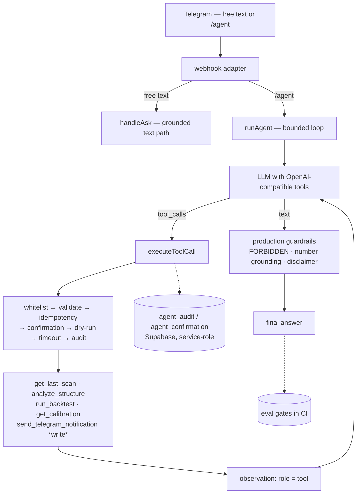

# Althunter — Grounded Agentic Analyst

**Portfolio entry for LLM / Agent Application Engineer roles.**

Althunter is a crypto market research assistant that started as a Telegram chatbot and was extended into a **grounded agentic analyst**: an LLM that can choose from a small set of real tools, call them under a strict safety pipeline, and produce an answer whose numbers can be traced back to the engine that produced them.

The domain is crypto research. The engineering — tool orchestration, guardrails, evaluation, audit and cost control — is the part that transfers to any customer-facing LLM product.

> This is a research/simulation tool. Not financial advice, not broker execution.

## What it does

- **Answers with anchors, not memory.** Every answer is built from a persisted scan snapshot plus explicitly labelled live data. ADR 0002 explains why vector RAG was rejected in favour of auditable context assembly.
- **Uses tools instead of guessing.** The agent can fetch the last scan, analyse price structure, run a deterministic backtest and read signal calibration. It cannot invent a number that is not in the context or in a tool result.
- **Treats writes as a human decision.** The only side-effecting tool (sending a Telegram notification) is confirmation-gated. `/confirm` replays the exact stored tool call — the model does not get to re-decide the arguments.
- **Is evaluated offline, in CI.** Two gates: one for answer quality, one for agent behaviour (tool selection + task completion).

## Architecture



The core (`lib/agent/`) is transport-agnostic: `types`, `schema`, `executor`, `loop`, `llm`, `tools` import no Telegram or Next.js code. Only the optional durable adapters in `audit.ts` reach for Supabase, and they fall back to in-memory stores when the admin key is absent.

## Engineering highlights

| Concern | Decision | Why it matters |
|---|---|---|
| Tool arguments | Hand-rolled validator, no zod/LangChain | Keeps the core dependency-free and the audit/error path fully controlled |
| Write safety | Confirmation gate + idempotency key + dry-run + 8s timeout | An LLM can propose a side effect but cannot silently perform one |
| Replay | `/confirm` executes the stored tool call verbatim via `replayCall` | Closes the "model changed its mind" hole that fails most agent demos |
| Budget | Max 4 steps, max 3 tool calls | Bounds latency and token cost per conversation |
| Grounding | Numbers allowed from context **and** accepted tool observations | Tool-sourced facts are not mistaken for hallucinations |
| Audit | Every path writes an `AuditRecord`; durable table with unique executed keys | Retries cannot double-send, and every decision is traceable |
| Evaluation | 19 chatbot cases + 14 scripted agent cases, both in CI | Quality is measured, not assumed |

## Verification

```
typecheck   ✓
tests       ✓ 76 / 76 across 11 files
npm run eval        ✓ 19/19 — answer quality
npm run eval:agent  ✓ 14/14 — tool selection + task completion
build       ✓
```

Reports: `eval/reports/latest.md` and `eval/reports/agent-latest.md`.

## Read next

- [Agent architecture](docs/agent-architecture.md) — modules, tool table, safety model, limitations
- [ADR 0004 — agentic tool calling](docs/adr/0004-agentic-tool-calling.md)
- [ADR 0002 — grounded answers](docs/adr/0002-grounded-answers.md)
- [Agent quality standard](docs/evaluation/agent-quality.md)
- [Engineering journal](docs/engineering-journal.md) — five real bugs found and fixed
- [Demo walkthrough](docs/demo/agent-transcript.md) — one request from question to audited answer

## Honest limitations

Opt-in path, not the default chat; single chat id; durable stores require a manually applied migration and a service-role key; agent evaluation uses scripted LLM turns rather than live traffic; no real user-satisfaction signal yet. Each of these is documented rather than hidden.
