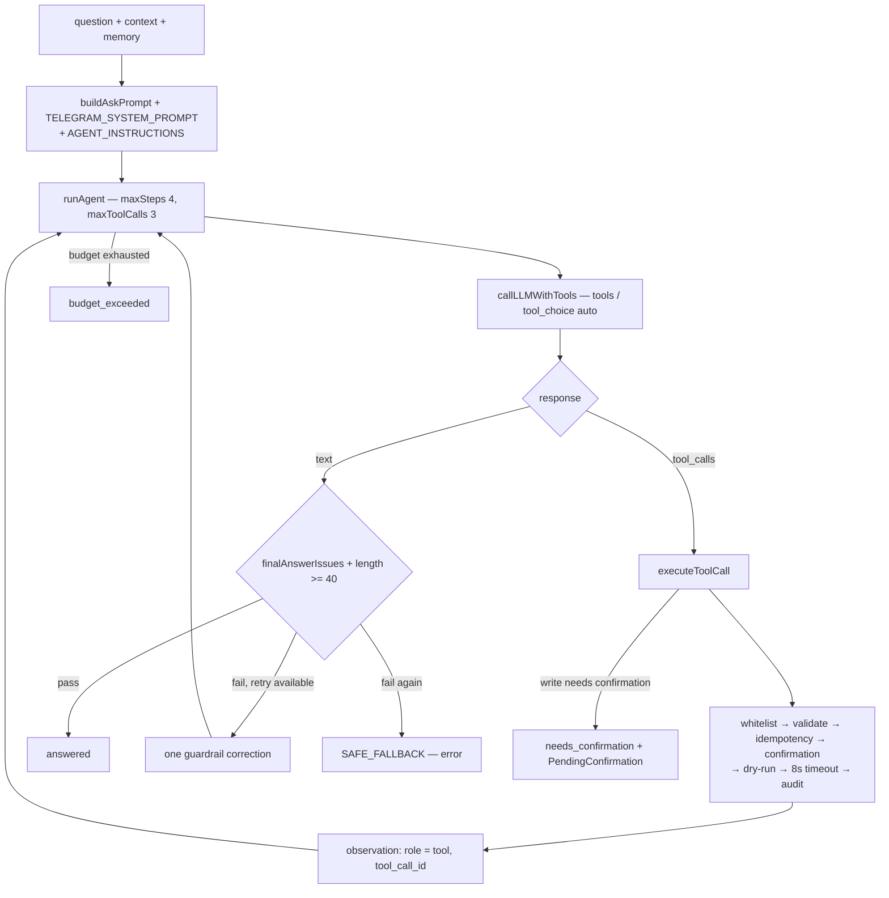

# Agentic runtime architecture

This document describes the agent layer of Althunter for an engineering audience. For the rationale behind the decisions, see [ADR 0004](./adr/0004-agentic-tool-calling.md) and [ADR 0002](./adr/0002-grounded-answers.md).

## Positioning

This is a **grounded agentic analyst**, not a generic chatbot. The model does not free-form answer from memory and does not talk to backends directly: it is given a small, curated set of tools over Althunter's existing deterministic engine, every tool call passes through validation, idempotency, confirmation and audit, and the final text is checked with the *same* production guardrails as the Telegram assistant. The runtime is library-first and transport-agnostic — the core modules (`types`, `schema`, `executor`, `loop`, `llm`, `tools`) import no Telegram, Next.js or Supabase code. Only the optional durable adapters in `audit.ts` reach for the Supabase service-role client, and they fall back to in-memory stores when it is not configured. It is wired into the Telegram webhook as an **opt-in path**: `/agent <question>` runs the agent, and `/confirm <token>` completes a gated write. Ordinary free-text chat still goes through `handleAsk()` with text-only `callLLM()`, so the existing assistant is untouched. Both paths share the same prompt source (`buildAskPrompt`, `TELEGRAM_SYSTEM_PROMPT`).

## Module map

| File | Responsibility |
|---|---|
| `types.ts` | Contracts only: `ToolDefinition`, `ToolCall`, `AgentPolicy`, `AuditSink`, `AgentDeps`, `AgentResult` (including `state` and token `usage`). No runtime dependencies. |
| `schema.ts` | Hand-rolled argument validator and the deterministic `idempotencyKey()` / `describeCall()` helpers. No zod. |
| `audit.ts` | `InMemoryAuditSink`, `SupabaseAuditSink`, `SupabaseConfirmationStore`, `InMemoryConfirmationStore`, `createAuditRecord()`, and `getDefault*()` factories that pick durable stores when the admin client exists. |
| `executor.ts` | The single safe path for any tool call: whitelist → validate → idempotency → confirmation → dry-run → timeout → audit. |
| `llm.ts` | `callLLMWithTools()`: OpenAI-compatible `tools` / `tool_choice: 'auto'`, reusing `llmEnv()`. Separate from text-only `callLLM()`. |
| `loop.ts` | `runAgent()`: bounded LLM → tool → observation → LLM loop, final-answer guardrail, retry and fallback. |
| `tools.ts` | Five concrete tools wrapping already-tested backend functions, plus `MARKET_TOOLS`, `READ_ONLY_TOOLS` and `AGENT_POLICY`. |
| `index.ts` | Public entry point. Consumers import from `lib/agent`, never from internal files. |

## Flow

## Tools

Every tool wraps an existing, tested backend function. Read tools return deliberately compact projections — never raw 100 KB scan payloads — so the model's context stays small and numbers remain traceable to the engine.

| Tool | Scope | Wraps | Side effects |
|---|---|---|---|
| `get_last_scan` | read | `getLastScan('BTCUSDT')` | None. Returns scan time, regime, total scanned and top 5 rankings (symbol, signal, score, age). |
| `analyze_structure` | read | `fetchKlinesRouted` + `analyzeStructure` | None. Fetches 200 candles; returns trend, support, resistance and up to 3 patterns. |
| `run_backtest` | read | `fetchKlinesRouted` + `detectDecoupling` + `runBacktest` | None. Deterministic backtest config fixed in code; returns trades, win rate, PnL, drawdown, Sharpe, alpha. |
| `get_calibration` | read | `getSupabase()` + `readCalibration` + `calibrationLines` | None. Tracker of past signals; small samples are redacted to text by the production helper. |
| `send_telegram_notification` | write | `sendTelegramMessage` | **Sends a real Telegram message to the owner chat.** Confirmation-gated, dry-run by default until confirmed, text capped at 4000 characters. |

Only the write tool requires confirmation in `AGENT_POLICY`. Note that a `write` tool *not* listed in `policy.requireConfirmationFor` is forced into dry-run rather than executed — the confirmation list is also an execution allowlist for writes.

## Safety model

1. **Whitelist.** `runAgent` filters the tool list before it ever reaches the model; `executeToolCall` repeats the check against `policy.allowedTools`.
2. **Argument validation.** `validateToolArgs()` coerces/checks `string`, `number`, `boolean` and `string[]`, enforces `required`, `enum`, `min`/`max`, and rejects unknown keys. Invalid calls never reach a backend.
3. **Idempotency.** `idempotencyKey()` = first 32 hex chars of `sha256(chatId \0 toolName \0 JSON.stringify(args, Object.keys(args).sort()))`. A matching `executed` audit record replays its stored result instead of re-running the tool.
4. **Confirmation gate.** For `scope: 'write'` tools in `policy.requireConfirmationFor`, the executor returns `needs_confirmation` with a `PendingConfirmation` (token, args, description, `expiresAt` = 5 minutes) and the instruction `/confirm <token>`. The caller must add the token to `confirmedKeys` and re-run.
5. **Dry-run and timeout.** Writes without a confirmed key are previewed only. Actual execution is wrapped in an 8-second `Promise.race` timeout (`tool.timeoutMs` can override).
6. **Audit on every path.** Statuses: `executed`, `dry_run`, `cached`, `rejected`, `failed`, `needs_confirmation`. `AgentResult.audit` is the local trace for a run; `AgentDeps.audit` is the sink boundary. By default the webhook uses `SupabaseAuditSink` writing to `agent_audit` (migration 022, service-role only, partial unique index on executed idempotency keys), with an in-memory fallback for local tests.

7. **Durable confirmation + exact replay.** Pending confirmations live in `agent_confirmation`, not a process-local Map. `/confirm` consumes the token once (5-minute TTL), then `runAgent` receives `replayCall` — the stored tool name and raw arguments — so the write executes **exactly what the user approved**. The model is only asked to compose the final answer, not to re-decide the tool call.
8. **Output guardrails.** `runAgent` applies production `FORBIDDEN` regexes, checks numbers against `numbersIn(context)` **plus numbers returned by accepted tool observations** with `isKnownNumber`, requires both disclaimer fragments, rejects JSON/code artifacts and answers shorter than 40 characters, allows one correction turn, and falls back to `SAFE_FALLBACK`. The result carries `state` and `usage` for tracing.

### Prompt reuse

`runAgent` builds its user message with `buildAskPrompt()` and defaults its system prompt to `TELEGRAM_SYSTEM_PROMPT + AGENT_INSTRUCTIONS`. There is one source of truth for persona, scope and disclaimer rules; a change to the production prompt applies to both the chatbot and the agent.

## LLM adapter

`callLLMWithTools()` uses the same `llmEnv()` (base URL, API key, model, max tokens) as the text path, serializes tool params to JSON schema with `additionalProperties: false`, sets `tool_choice: 'auto'`, and normalizes provider `tool_calls` back into the internal `ToolCall` shape. Reasoning-only model output is accepted as content. A provider without `tools` support degrades to a single text answer — the loop simply sees no tool calls.

## How the evaluation harness connects

`eval/` has two offline gates, both wired into CI:

- `eval/dataset.jsonl` + `eval/judge.ts` evaluate the **text-only chatbot** with rule checks that reuse production guardrails. Run with `npm run eval`.
- `eval/agent/dataset.jsonl` + `eval/agent/judge.ts` evaluate the **agent** with 14 scripted cases. Run with `npm run eval:agent`. `finalAnswerIssues` and `AGENT_INSTRUCTIONS` are exported from `loop.ts` so the same guardrails are exercised.

The agent gate measures two things that prose evaluation cannot:

- **Tool-selection accuracy** — did the model pick the right tool with valid arguments, and did it avoid executing a write tool without confirmation? Scored from `AgentResult.audit` and fake-tool call counters, not from the final text.
- **Task completion** — did the loop reach `answered` within the step/tool budget with a guardrail-clean answer grounded in the fixture, and did it degrade to `SAFE_FALLBACK` / `needs_confirmation` where it should?

Details in [agent-quality.md](./evaluation/agent-quality.md). Both gates are fully offline: scripted LLM turns and fake tools, no API key, no network, no Supabase.

## Current limitations

- **Opt-in, not default.** `/agent` and `/confirm` are explicit commands; normal free-text chat keeps using the original assistant. The agent is reachable but not the default experience.
- **Single chat id.** The surrounding product serves one owner chat (`TELEGRAM_CHAT_ID`); there is no multi-tenancy, per-tenant policy or allowlist in the agent layer.
- **Durability depends on admin credentials.** With `SUPABASE_SERVICE_ROLE_KEY` and migration 022 applied, audit rows and pending confirmations survive redeploys and are shared across instances. Without them, both sinks silently fall back to per-process in-memory stores — safe for local development, not a production guarantee. The migration must be applied manually.
- **Number guardrail combines context and tool observations.** Numbers returned by accepted tools are allowed; anything else is rejected. This is intentionally strict for a financial assistant.
- **Curated evaluation baseline.** The eval fixture and dataset are hand-curated; no tool-selection or task-completion metrics exist yet, and there is no LLM judge for agent trajectories.
- **No real traffic.** All results to date come from scripted/offline runs; latency, token cost and tool failure rates under real usage are unknown.
- **Confirmed keys remain valid for the process lifetime.** After a token is consumed, its idempotency key stays in the per-chat confirmed set until restart. That is deliberate: idempotent replay must not expire with the 5-minute confirmation window. A confirmed key is single-use through `/confirm` even though the key itself is remembered.
- **Fixed, small toolset.** Projections are intentionally lossy; the agent cannot inspect raw scan payloads or call arbitrary backend functions.
